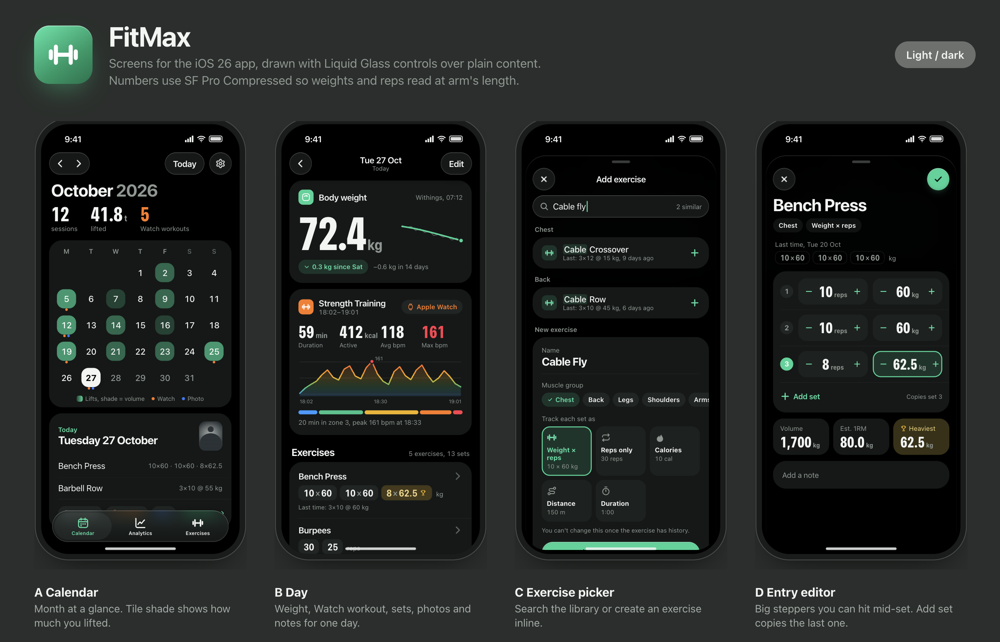

- title: My First iOS App with Claude
- date: 2026-11-08

Since I started working out, one thing I wished I had was a nice app to track my workouts, one that syncs with iCloud and also pulls data from my Apple Watch workouts. When I looked into iOS apps, all the good ones were free to try but then needed a subscription, and the free apps were either too basic or came with unnecessary tutorials, exercise videos and other bloated features. I've never built an iOS app, but now that LLMs have become cheap enough, I wanted to give it a shot with Claude Code over the weekend.

The first thing I did with Claude was a brainstorming session where I noted down my main requirements. Basically, for a given day I want to note down the exercises I did, how many sets/reps or the duration/calories for each exercise, upload a picture of my physique so I can compare the visual change of my body against past pictures, pull data from my Apple Watch workouts, and have it all synced to iCloud. I used Opus for this, and we went back and forth and came up with a `plan.md` file with a breakdown of how the app should be implemented. I left it to the LLM to decide how the app should be structured and the iOS-specific stuff, since I had no idea about Swift. But I did want to know how the data would be stored in iCloud (basically the data layer), so I could make sure it was storing exactly what I need.

After that, I again used Opus, this time with the frontend-design plugin, to come up with one-page HTML files containing the design of the app. For me this was the important part, since that's what I would be using, and it had to be simple and easy to use. Surprisingly, after reading the `plan.md` file, Opus was able to come up with a design pretty close to the final result without much guidance. I did go through the screens and nitpicked a bit, but it was pretty good and captured my requirements.

Then I used Sonnet to implement the app step by step, and all the commands, app builds etc. were done by Haiku agents. Granted, it's a pretty simple app, no backend, just a UI that syncs to iCloud, but after using it for the first time I was ecstatic. As someone with zero app development experience, being able to build a simple app from just an idea within a few hours and actually use it was quite mind-blowing. I probably won't publish it to the App Store, since it's only for my use case and I can't be bothered to go through Apple's app review process. But would I build more apps for other niche use cases I have? Abso-fucking-lutely. This opens up a completely different set of possibilities, and the next thing I'm going to try is writing an Apple Watch app to go together with the iOS app, so I can edit workout details directly from my watch.

A year ago, had I wanted to write an iOS app, it would have taken me weeks or months to learn Swift and all the iOS gotchas, but now it can be done within hours with the help of AI. It's indeed a vibe-coded app, because I don't know the Swift code underneath in detail, but that's the fun part. Now I can go through it and figure out what it does, and if I don't understand something or need it made clearer, I can always ask Claude to explain it to me.

**PS:** Here's a screen recording of the app running on my iPhone.

<video src="./images/first-ios-app-demo.mp4" controls playsinline></video>
